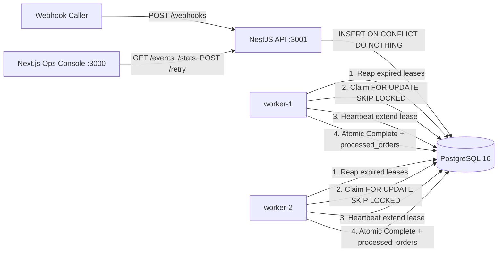

# Reliable Webhook Processor

A durable, concurrency-safe webhook ingestion and processing system built with **NestJS**, **Next.js (App Router)**, **PostgreSQL 16**, **Drizzle ORM**, and **Docker Compose**.

---

## Architecture



### Worker Coordination Protocol
1. **Atomic Ingestion (`POST /webhooks`)**: Validates payload with Zod and runs a single `INSERT INTO events ... ON CONFLICT (event_id) DO NOTHING RETURNING event_id` committed before returning `202`. On conflict, an atomic `UPDATE` increments `duplicate_count` and (if the canonical JSON SHA-256 differs) `conflicting_payload_count`, logging a warning without overwriting `payload` or `status`.
2. **Reaper (Step A of each tick)**: Queries `status = 'processing' AND lease_expires_at < now()` with `FOR UPDATE SKIP LOCKED`. Inside one transaction, it marks the open `event_attempts` row `'abandoned'` and either moves the event to `'failed_permanent'` (if budget exhausted) or back to `'pending'` with exponential backoff.
3. **Claim (Step B of each tick)**: Selects one eligible event (`status = 'pending' AND next_run_at <= now()`) via `FOR UPDATE SKIP LOCKED`, transitions it to `'processing'`, sets `locked_by`, `lease_expires_at = now() + LEASE_MS`, increments `attempt_count` and `attempts_in_budget`, and inserts an open `event_attempts` row. Processing executes **outside** any DB transaction.
4. **Heartbeat & Cancellation**: Every `HEARTBEAT_MS` (`< LEASE_MS / 3`), the worker extends `lease_expires_at` using the fencing predicate `(event_id, locked_by, attempt_count, status='processing')`. If `0` rows match, the lease was lost and an `AbortController` immediately aborts in-flight execution.
5. **Fenced Completion**: Success updates `events` with the fencing predicate (`locked_by`, `attempt_count`, `status='processing'`), inserts into `processed_orders ... ON CONFLICT (event_id) DO NOTHING`, and closes `event_attempts` as `'success'` inside **one transaction**. If `0` event rows match, the transaction rolls back so a stale worker never writes business state.

---

## Libraries and Why

| Package | Purpose | Reason |
|---|---|---|
| `@nestjs/common`, `@nestjs/core` | API & headless worker DI container | Clean separation between HTTP (`src/main.ts`) and headless workers (`src/worker.ts`) over shared DB/domain modules |
| `pg` + `drizzle-orm` + `drizzle-kit` | Postgres pool, typed schema, SQL migrations | Explicit connection pooling (`pg.Pool`) and raw `sql` support for `FOR UPDATE SKIP LOCKED` and fencing predicates |
| `zod` | Request & boot-time env validation | Strict runtime schema validation with fail-fast config errors and detailed 400 responses |
| `nestjs-pino` + `pino` | Structured JSON logging | Low-overhead structured logs tagged with `workerId`, `eventId`, and `attempt` |
| `next` (App Router) | Ops dashboard (`/`) | Minimal single-page console with 2s polling, filtering, pagination, expandable attempt history, and manual retry |
| `jest` + `ts-jest` + `supertest` | Unit & real-Postgres concurrency tests | Verifies parser edge cases and real DB locking/fencing without mocks |

---

## Correctness Guarantees

- **Duplicate Ingestion Protection**: Enforced by PostgreSQL `PRIMARY KEY (event_id)` + `INSERT ... ON CONFLICT (event_id) DO NOTHING`. Concurrent identical or conflicting requests never double-enqueue or overwrite the initial payload.
- **No Double Claiming**: Enforced by `FOR UPDATE SKIP LOCKED` inside the claim transaction. Concurrent workers never block each other or claim the same row.
- **Atomic Business Action & Completion**: `UPDATE events ... SET status='succeeded'`, `INSERT INTO processed_orders ... ON CONFLICT (event_id) DO NOTHING`, and `UPDATE event_attempts` execute in one transaction. A crash before commit rolls back everything; `UNIQUE(event_id)` on `processed_orders` prevents duplicate business records.
- **Fencing Token (`attempt_count` + `locked_by`)**: Every claim monotonically increments `attempt_count`. Heartbeats and completions require `WHERE event_id=$1 AND locked_by=$2 AND attempt_count=$3 AND status='processing'`, guaranteeing a paused/stale worker cannot overwrite a newer worker's state.
- **At-Least-Once Execution, Exactly-Once Effect**: Crashes or expired leases re-drive execution on a surviving worker, while fencing + `UNIQUE(event_id)` ensures at most one `processed_orders` row per event.

---

## Known Limitations

1. **External Side Effects Outside DB Transactions**: While `processed_orders` is atomic with event completion, real external HTTP/email/payment calls in a production handler are not transactional; crashing mid-action can repeat the external call on retry, so downstream APIs must accept an idempotency key (`event_id`).
2. **Long GC Pauses / Network Partitions**: If a worker pauses longer than `LEASE_MS`, its heartbeat fails, the reaper marks the attempt `'abandoned'`, and the paused worker's local work is aborted/rolled back when it wakes.
3. **Clock Skew Avoidance**: All lease expirations and retry schedules use PostgreSQL `now()`, assuming Postgres is the single time authority; worker wall clocks are never trusted for lease math.
4. **Polling Latency**: Workers poll on `POLL_INTERVAL_MS` (plus jitter), adding up to ~`POLL_INTERVAL_MS` pickup delay when idle.
5. **Abandoned Attempts Consume Budget**: Crashed/timed-out attempts increment `attempts_in_budget`, so repeated worker crashes can exhaust `MAX_ATTEMPTS`.
6. **Unknown `simulate` Directives**: Unparseable `data.simulate` values log a warning and execute as `"ok"` instead of failing ingestion.
7. **Reaper Liveness**: Lease reaping runs inside worker ticks, so expired leases are only reclaimed while at least one worker process is alive.
8. **Payload Conflict Alerting**: Conflicting payloads increment `conflicting_payload_count` and log a warning, with no dedicated alert/webhook/PagerDuty sink.
9. **Single PostgreSQL Ceiling**: One Postgres instance is a single point of failure and caps sustained write throughput compared to partitioned brokers.

---

## Decisions & Assumptions

- **PostgreSQL Queue vs. Redis/BullMQ**: Using the `events` table directly avoids dual-write consistency bugs between a DB and an external broker—ingestion persistence and enqueueing happen in one atomic `INSERT`.
- **`order_id` Not Unique in `processed_orders`**: Only `event_id` has a `UNIQUE` constraint because multiple distinct webhook events (e.g., `order.created`, `order.updated`, `order.paid`) legitimately reference the same `order_id`.
- **202 on Conflicting Duplicate Payloads**: `POST /webhooks` always returns `202` with `duplicate: true` on conflict while preserving the first payload and tracking `conflicting_payload_count`, matching idempotent webhook receiver semantics.
- **`attempt_count` vs. `attempts_in_budget`**: `attempt_count` is monotonic across the lifetime of an event (keying `event_attempts(event_id, attempt_number)` and fencing tokens), whereas `attempts_in_budget` resets to `0` on `POST /events/:eventId/retry`.
- **Backoff Formula**: Exponential backoff with **equal jitter**: `cap = min(BACKOFF_MAX_MS, BACKOFF_BASE_MS * 2^(attemptsInBudget - 1))`, `delay = floor(cap/2 + rand() * cap/2)`. Equal jitter spreads retries while ensuring a bounded minimum wait between attempts.
- **Validation & `simulate` Assumptions**:
  - `POST /webhooks` rejects only structurally invalid bodies (missing/empty trimmed `eventId`, `type`, or `data.orderId`, or non-string optional `customerId`/`simulate`); extra JSON fields are preserved in `payload`.
  - Canonical JSON (recursively sorted keys) is hashed with SHA-256 so key-order differences do not trigger `conflicting_payload_count`.
  - `data.simulate` directive names are lowercase (`ok`, `always_fail`, `fail_then_succeed:N`, `slow:N`) with outer whitespace trimmed; invalid or out-of-range values fall back to `"ok"`, log a warning, and record the warning note on the `'success'` attempt row.
- **One-Shot `migrate` Service**: Running Drizzle migrations in a dedicated `migrate` container (`service_completed_successfully`) avoids concurrent migration races between `api`, `worker-1`, and `worker-2`.
- **Explicit Worker Services vs. `--scale`**: `docker-compose.yml` defines `worker-1` (`webhook-worker-1`) and `worker-2` (`webhook-worker-2`) with explicit `WORKER_ID`s and `restart: "no"` so `docker kill webhook-worker-1` cleanly demonstrates failover. To enable automatic restarts in production, change `restart: "no"` to `restart: unless-stopped`. To scale horizontally, add a `worker-3` block with `container_name: webhook-worker-3` and `WORKER_ID: worker-3`.

---

## What I'd Do Next (Priority Order)

1. **Idempotency Keys for Downstream Side Effects**: Pass `event_id` as an `Idempotency-Key` header/parameter to any real external service called during processing.
2. **Dead-Letter Alerting & Payload Conflict Alerts**: Emit webhook/Slack/metrics alerts when events hit `failed_permanent` or `conflicting_payload_count > 0`.
3. **Metrics & Distributed Tracing**: Expose Prometheus `/metrics` (queue depth, claim latency, attempt duration, heartbeat failures) and OpenTelemetry spans propagated from ingestion through worker execution.
4. **PostgreSQL `LISTEN/NOTIFY` Wakeup**: Trigger immediate worker wakeups on `INSERT` to eliminate `POLL_INTERVAL_MS` idle latency while keeping polling as a fallback.
5. **Webhook Auth / HMAC Signature Verification**: Verify provider HMAC signatures (`X-Signature-256`) on `POST /webhooks` using raw request bytes.
6. **Table Partitioning & Retention**: Range-partition `event_attempts` and archive terminal `events` rows to keep indexes small at high volume.
7. **Load Testing Beyond 500 Events**: Benchmark sustained bursts (5k–50k events) to tune `PG_POOL_MAX`, vacuum settings, and batch claiming.

---

## How to Run

### Start the full stack with Docker Compose
```bash
cp .env.example .env
docker compose up --build
```
- **Ops Console**: http://localhost:3000
- **API**: http://localhost:3001 (`GET /health`, `GET /stats`, `GET /events`, `POST /webhooks`)
- **Postgres**: `localhost:5432` (`webhook` / `webhook` / `webhook_processor`)

---

## How to Run Tests

```bash
cd backend

# Unit tests (simulation parser, abortable sleep, backoff math — no DB required)
npm run test:unit

# Full test suite (unit + real-Postgres integration & concurrency tests)
# Requires PostgreSQL running and DATABASE_URL set (defaults to localhost:5432/webhook_processor)
npm test
```

---

## Demo Scenarios

All scripts target `API_URL` (default `http://localhost:3001`) and use unique `eventId` suffixes so they can be re-run safely:

| Scenario | Script | What It Demonstrates |
|---|---|---|
| Simultaneous duplicates | `bash scripts/demo/duplicate.sh` | 20 parallel `POST /webhooks` with same `eventId` -> all 202, `duplicate_count=19`, 1 `processed_orders` row |
| Temporary failure & retry | `bash scripts/demo/temporary-failure.sh` | `fail_then_succeed:2` fails attempts 1 & 2 with backoff, succeeds on attempt 3 |
| Permanent failure | `bash scripts/demo/permanent-failure.sh` | `always_fail` stops at `MAX_ATTEMPTS` with `failed_permanent` (pass `--retry` to trigger manual retry) |
| Parallel worker execution | `bash scripts/demo/parallel.sh` | 8 `slow:5` events distributed across `worker-1` and `worker-2` with overlapping timestamps |
| Worker crash & reaper takeover | `bash scripts/demo/crash.sh` | Submits `slow:30`, runs `docker kill` on the claiming worker, verifies lease expiry -> `'abandoned'` -> takeover & completion |
| 500-event burst | `bash scripts/demo/burst.sh` | Fires 500 mixed events concurrently, measures ingestion latency, waits until all reach terminal status |
